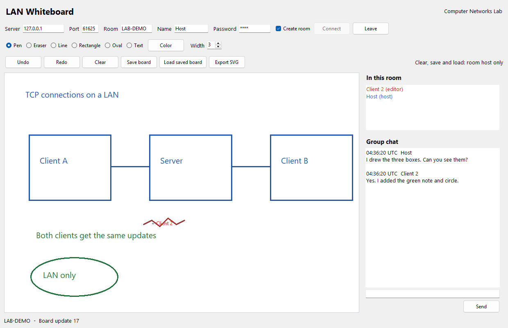

# LAN Whiteboard

Computer Networks lab project. One computer runs the TCP server. Other computers
join a room and use the same drawing board and chat.



## Run it

The Windows applications are in `release`. Python is not needed to run the EXEs.

1. Start `WhiteboardServer.exe` on one computer. Leave its console open.
2. Start `WhiteboardClient.exe`. On the server computer, enter `127.0.0.1` as the
   server address and `5050` as the port.
3. Enter a room code, your name and a password. Tick **Create room** and connect.
4. On the other computers, enter the server computer's LAN IPv4 address instead
   of `127.0.0.1`. Use the same room and password, without ticking Create room.

Run `ipconfig` on the server computer to find its IPv4 address. Allow the server
through Windows Firewall on the private network. Keep all computers on the same
LAN. Internet is not needed, but the LAN connection must stay on.

To use a different port or state file:

```powershell
.\release\WhiteboardServer.exe --port 6060 --storage .\sessions.json
```

## Board controls

- Pen, eraser, line, rectangle, oval and text, with a color picker and width setting.
- A participant list, named cursors and group chat with sender names and UTC times.
- Undo and redo for your own drawing. One mouse drag counts as one stroke.
- **Save board** keeps one shared snapshot. **Load saved board** restores it.
  Only the room host can save, load or clear the board.
- **Export SVG** saves a local image of the board.
- New participants receive the current board and recent chat.
- A dropped client reconnects automatically and catches up with the server.

The first person to create a room becomes its host. The client remembers that
identity in `.cn_whiteboard_tokens.json` in the Windows user's home folder.
Keep that file to recover host access after restarting the client.

## How it works

`server.py` keeps the board for each room. It checks each incoming action, assigns
an update number and sends the action to everyone in that room. A lock puts
simultaneous edits in one order. Each connection has its own outgoing queue.

`protocol.py` puts a four-byte length before each UTF-8 JSON message. The receiver
reads that many bytes, even if TCP splits the message across several reads.

`client.py` runs the socket connection in a worker thread. The Tk window reads
updates from a queue. Drawing coordinates use a fixed 0-10000 range so different
window sizes show the same board.

The server writes `sessions.json` after accepted changes. Restart it with the same
file to recover the rooms. Request IDs prevent a retried action from appearing
twice. A reconnecting client first receives a fresh copy of the board.

## Source and tests

Python 3.10+ with Tk is enough to run the source:

```powershell
python server.py
python client.py
python -m unittest -v
```

To rebuild the Windows EXEs, install PyInstaller and run `./build.ps1`.

The 10 tests cover message framing, invalid input, drawing tools, simultaneous
clients, room isolation, chat, host permissions, undo/redo and saved-state recovery.
The GUI check used two client windows on this computer. Screenshots are in
[`release/screenshots`](release/screenshots). They show a local test session,
not a test between two physical computers.

## Demo and submission

The report and slides are in `release`. See [`TEAM_RECORDING.md`](release/TEAM_RECORDING.md)
for the demo order and viva topics. Add the recorded explanation before submitting.
The assignment deadline is 15 November 2026,
11:55 pm IST.

Before the lab demo, try the submitted ZIP on two computers with internet disabled.
Check simultaneous drawing, late joining, chat, undo/redo, save/load and reconnect.

## Limits

A room keeps 1000 drawing segments, 500 chat messages and one saved board. The
server accepts up to 64 connections. Clear a full board after exporting it.
Drawing again after undo discards your redo history. Clear starts a new history.

Room passwords and board contents travel without encryption. Use a trusted LAN.
Host access stays with the original host's saved identity. There is no offline
editing or automatic host transfer.
